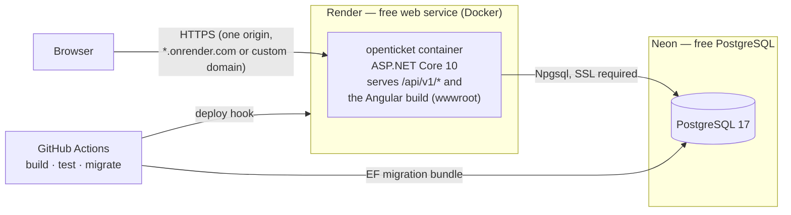
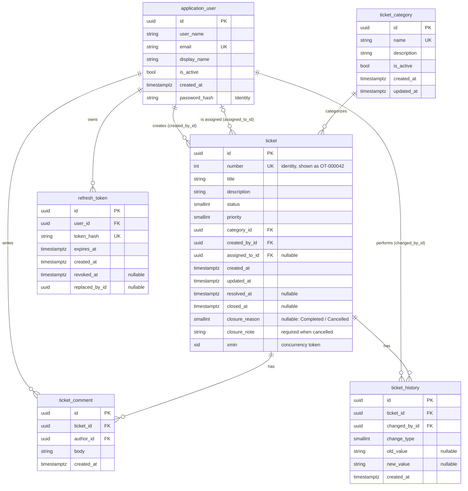
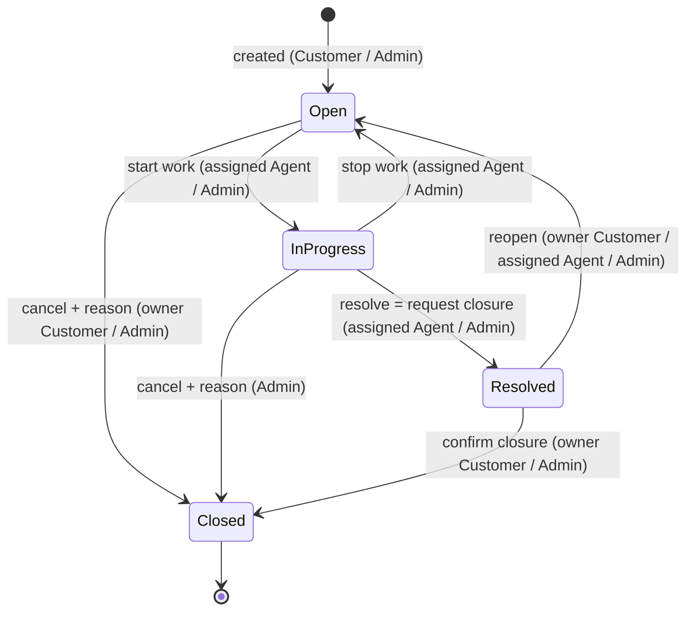
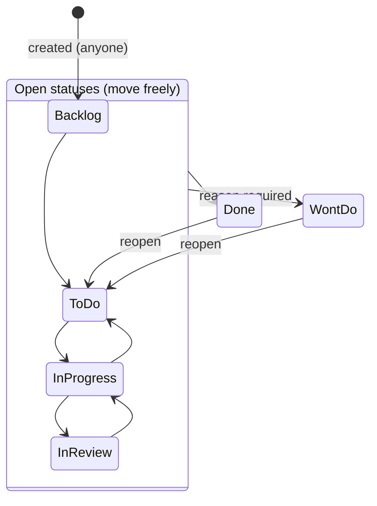

# OpenTicket — Phase 1: Architecture & Database Design

Status: **Draft for review** · Date: 2026-11-07

This document is the Phase 1 deliverable. No application code exists yet. Decisions marked **[Decision]** are the ones you should confirm or push back on. Open questions are listed at the end.

---

## 0. Scope and non-goals

**In MVP:** the authentication, tickets, workflow, priority, comments, history, dashboard and categories described in the brief, plus the infrastructure needed to run it for free.

**Not in MVP (deliberately):** email notifications, password reset by email, file attachments, SLAs and auto-escalation, internal or private agent notes, multi-tenancy, full-text search, real-time updates (SignalR), external SSO, and auto-closing resolved tickets after N days. Each of these is a clean add-on later. None of them changes the core schema.

---

## 1. System architecture

### 1.1 Deployment view

**Production (free hosted):**



**Local development:** `docker compose up` starts PostgreSQL (and optionally the same app image). `ng serve` proxies `/api` to the API through `proxy.conf.json`.

**[Decision] One container serves both the API and the Angular app.** A multi-stage Dockerfile builds the Angular app and copies it into the API's `wwwroot`. ASP.NET Core serves the static files and falls back to `index.html` for SPA routes. This means:
- **only one free service** to host, with no nginx and no separate static host;
- **one origin**, so the refresh-token cookie can be `HttpOnly; Secure; SameSite=Strict`;
- **no CORS anywhere**, not even in development, thanks to the `ng serve` proxy.

Render terminates TLS and provides the HTTPS certificate, including for a custom domain, at no cost.

### 1.2 Solution layout (Clean Architecture, modular monolith)

```
src/
  OpenTicket.Domain/          Entities, enums, workflow rules. No dependencies.
  OpenTicket.Application/     Use-case services, DTOs, validation, Result type,
                              interfaces for infrastructure (IAppDbContext, ITokenService, IClock via TimeProvider).
  OpenTicket.Infrastructure/  EF Core DbContext, configurations, migrations, Identity,
                              JWT issuing, refresh-token store, seeding.
  OpenTicket.API/             Minimal-API endpoint groups (/api/v1), auth setup,
                              exception handler, ProblemDetails, OpenAPI, rate limiting.
web/
  openticket-web/             Angular SPA
tests/
  OpenTicket.UnitTests/       Domain + Application tests (no DB)
  OpenTicket.IntegrationTests/ WebApplicationFactory + Testcontainers PostgreSQL
```

Dependency direction: `API → Application → Domain` and `API → Infrastructure → Application → Domain`. Domain references nothing.

Inside Application and API, code is grouped **by feature** (the "modules" of the monolith), not by technical layer:

```
Application/
  Auth/  Tickets/  Comments/  Categories/  Users/  Dashboard/  Common/
```

### 1.3 Key technical decisions

| # | Decision | Why |
|---|---|---|
| D1 | **Minimal APIs with route groups** (`MapGroup("/api/v1/tickets")`), not controllers | Less ceremony. .NET 10 has built-in validation for minimal APIs and first-class OpenAPI support. |
| D2 | **No MediatR, no AutoMapper.** Use plain application services (`TicketService`, …) and hand-written mapping extension methods | Both libraries moved to commercial licenses in 2025, which conflicts with "no paid dependencies". Plain services are also easier to read. |
| D3 | **Result type** (`Result<T>` with `Error { Code, Message, Kind }`) for validation, not-found, forbidden and business-rule failures. A single mapper turns it into ProblemDetails | Expected failures stay values, and exceptions are reserved for bugs and infrastructure faults. |
| D4 | **Validation**: .NET 10 built-in minimal-API validation (DataAnnotations on request records) at the edge. Business rules (workflow transitions) live in Domain | No extra dependency. If the rules outgrow attributes we can add FluentValidation (Apache-2.0) later. |
| D5 | **Workflow logic lives on the `Ticket` entity** (`ticket.ChangeStatus(newStatus, actor)`), which returns a Result and records history entries | One place enforces the state machine, and it can be unit-tested without a DB. |
| D6 | **Authorization**: role policies (`AdminOnly`, `StaffOnly`) plus **ownership checks inside services** (customer → `CreatedById`, agent → `AssignedToId`). Unauthorized access to another user's ticket returns **404**, not 403 | Ticket IDs are never leaked or confirmed to non-owners. |
| D7 | **Auth**: ASP.NET Core Identity (`IdentityUser<Guid>`), a short-lived **JWT access token (15 min)** kept in memory by the SPA, and a **rotating refresh token (7 days)** stored **hashed** in the DB and sent as an HttpOnly cookie | The brief requires logout. Pure JWT can't be revoked, so the refresh-token table is what makes logout and session revocation real. |
| D8 | **GUID v7 keys** generated in .NET (`Guid.CreateVersion7()`) and stored as PostgreSQL `uuid` | Time-ordered GUIDs avoid the B-tree index fragmentation that random v4 GUIDs cause. |
| D9 | **Human-readable ticket number** (`Number`, an identity column, displayed as `OT-000042`) next to the GUID PK | Users quote "OT-42" on the phone, not a GUID. |
| D10 | **Optimistic concurrency** via PostgreSQL `xmin` mapped as a row version on `Ticket` | Two agents editing the same ticket get a 409, not a silent overwrite. |
| D11 | **snake_case table/column names** via `EFCore.NamingConventions` (PostgreSQL License, maintained by the Npgsql team) | Idiomatic in PostgreSQL. PascalCase identifiers would need quoting in every hand-written SQL query. *Deviates from my SQL Server naming default on purpose.* |
| D12 | **Logging**: built-in `ILogger` with the JSON console formatter, plus request logging and a correlation ID (`traceId` in ProblemDetails) | Structured logs without Serilog. `docker logs` is the free log sink. |
| D13 | **OpenAPI**: built-in `Microsoft.AspNetCore.OpenApi` document, with Swagger UI (`Swashbuckle.AspNetCore.SwaggerUI` only) enabled in Development | The brief asks for Swagger, and the built-in generator is the supported path in .NET 10. |
| D14 | **Timestamps** in UTC (`DateTime` Kind=Utc → `timestamptz`), supplied through `TimeProvider` | Npgsql requires UTC for `timestamptz`, and `TimeProvider` makes time testable. |
| D15 | **Database migrations** in Production run from GitHub Actions as an **EF Core migration bundle** against Neon, *before* the deploy hook fires. They never run automatically on API startup. Development auto-migrates for convenience | Avoids surprise schema changes on a cold start. Render's free tier has no pre-deploy command, so CI is the free place to run them. |
| D16 | **Rate limiting** (built-in middleware) on `/auth/*` endpoints | Basic brute-force protection at no cost. |

### 1.4 Request pipeline (API)

```
ForwardedHeaders → ExceptionHandler (ProblemDetails) → HSTS/security headers
→ RequestLogging → RateLimiter → Authentication → Authorization → Endpoints
```

- Unhandled exceptions are logged once and returned as a 500 ProblemDetails with `traceId` and no internal detail.
- Result failures map to ProblemDetails: `Validation → 400` (with an `errors` dictionary), `NotFound → 404`, `Conflict → 409`, `Forbidden → 403`, `BusinessRule → 422`.

### 1.5 Configuration

Configuration is environment-based (`appsettings.json` → `appsettings.{Environment}.json` → environment variables). Secrets come **only** from environment variables or `dotnet user-secrets` locally:

| Key | Example (`.env.example`) |
|---|---|
| `ConnectionStrings__Default` | `Host=db;Database=openticket;Username=openticket;Password=change-me` |
| `Jwt__Issuer` / `Jwt__Audience` | `openticket` |
| `Jwt__SigningKey` | *(≥ 32 random bytes, base64, generated per deployment)* |
| `Seed__AdminEmail` / `Seed__AdminPassword` | Creates the first Admin on first start, only if no admin exists |
| `POSTGRES_PASSWORD` | used by the local db container only |

In production these values are set as **Render environment variables** (the app) and **GitHub Actions secrets** (the migration connection string and the deploy-hook URL). They never go in the repo. The Neon connection string must include `SSL Mode=Require`.

### 1.6 Free hosting (detail in Phase 10)

**[Agreed] Free hosted.** The target stack costs $0/month and needs no credit card:

| Piece | Service | Free-tier facts as I know them (re-check at deploy time, since free tiers change) |
|---|---|---|
| App (API + SPA) | **Render** free web service, built from the repo's Dockerfile | 512 MB RAM. **Sleeps after ~15 min idle; the first request after that takes ~30–60 s to wake.** Free HTTPS and custom domain. Auto-deploys from GitHub |
| Database | **Neon** free PostgreSQL | ~0.5 GB storage and a monthly compute-hours allowance. Suspends when idle and wakes in under a second. Daily point-in-time restore window |
| CI | **GitHub Actions** | Free for public repositories, with a free minutes allowance for private ones |
| Source | **GitHub** | Free |

The main trade-off is the **cold start**. The first visitor after a quiet period waits up to about a minute, which is acceptable for a small team but not for a busy help desk. I won't add a "keep-alive pinger" to dodge the sleep, because that works against the free tier's terms. Two upgrade paths need no code change, because the app is a plain container plus a connection string:
- **Koyeb** free instance (same model: one container, scales to zero), as an alternative to Render;
- **Self-hosted Docker** (home server or Oracle Cloud Always Free VM) with the provided `docker-compose.yml`, for no cold starts.

**Not chosen:** Vercel Hobby (non-commercial use only, which rules out small businesses), Fly.io (no longer has a free tier for new accounts), Azure App Service F1 (a 60 CPU-minutes/day quota).

---

## 2. Database ERD



Identity's own tables (`role`, `user_role`, `user_claim`, `user_login`, `user_token`, `role_claim`) exist too. They're omitted from the diagram for readability.

---

## 3. Database schema

PostgreSQL 17. Tables use singular snake_case names. All PKs are `uuid` (v7, app-generated) unless noted. All timestamps are `timestamptz` in UTC. Timestamp columns carry a `_utc` suffix in the implemented schema (e.g. `created_at_utc`), and `ResolvedAt`-style names below are shortened for readability.

### 3.1 `application_user` (extends Identity `IdentityUser<Guid>`)

| Column | Type | Constraints |
|---|---|---|
| id | uuid | PK |
| user_name, normalized_user_name | varchar(256) | unique index on normalized (Identity) |
| email, normalized_email | varchar(256) | **unique** index on normalized_email (`RequireUniqueEmail = true`) |
| password_hash, security_stamp, concurrency_stamp, lockout_*, … | Identity defaults | |
| display_name | varchar(100) | not null |
| is_active | boolean | not null, default true |
| created_at | timestamptz | not null |

- Roles are the Identity roles `Admin`, `Agent` and `Customer`. **[Decision] Each user has exactly one role** in the MVP, which keeps the authorization rules unambiguous.
- Users are deactivated (`is_active = false`), never deleted, because tickets and comments reference them. Deactivating a user revokes their refresh tokens. Login checks `is_active`.
- Lockout: 5 failed attempts → 15 minutes (Identity lockout).

### 3.2 `ticket_category`

| Column | Type | Constraints |
|---|---|---|
| id | uuid | PK |
| name | varchar(100) | not null |
| normalized_name | varchar(100) | not null; **unique**. Trimmed, upper-cased copy of `name`, set by the domain, so uniqueness is case-insensitive |
| description | varchar(500) | null |
| is_active | boolean | not null, default true |
| created_at, updated_at | timestamptz | not null |

Inactive categories can't be chosen for new tickets but stay on existing ones. Categories are never deleted.

### 3.3 `ticket`

| Column | Type | Constraints |
|---|---|---|
| id | uuid | PK |
| number | integer | `GENERATED BY DEFAULT AS IDENTITY`, **unique** |
| title | varchar(200) | not null |
| description | varchar(8000) | not null |
| status | smallint | not null; check in (0..3) |
| closure_reason | smallint | null; `Completed=0`, `Cancelled=1`. Check: not null **iff** status = Closed |
| closure_note | varchar(1000) | null; **required when closure_reason = Cancelled** (check constraint) |
| priority | smallint | not null; check in (0..3) |
| category_id | uuid | FK → ticket_category, `ON DELETE RESTRICT` |
| created_by_id | uuid | FK → application_user, `RESTRICT` |
| assigned_to_id | uuid | FK → application_user, null, `RESTRICT` |
| created_at, updated_at | timestamptz | not null |
| resolved_at, closed_at | timestamptz | null |
| xmin | xid | system column mapped as concurrency token |

Enums are stored as smallint and mapped to C# enums. A check constraint guards the range.
- `TicketStatus`: Open=0, InProgress=1, Resolved=2, Closed=3
- `TicketPriority`: Low=0, Medium=1, High=2, Urgent=3
- `ClosureReason`: Completed=0, Cancelled=1

**[Agreed] Cancelling closes the ticket with a reason.** A cancel sets `status = Closed`, `closure_reason = Cancelled`, and a required `closure_note` holding the reason. A normal close after resolution sets `closure_reason = Completed`. The workflow keeps exactly the four states in the brief, and the reason stays visible on the ticket and in its history.

**Indexes** (each one matches a real query):

| Index | Serves |
|---|---|
| `ix_ticket_created_by_id_created_at` (created_by_id, created_at desc) | Customer "my tickets" list |
| `ix_ticket_assigned_to_id_status` (assigned_to_id, status) | Agent queue and the "assigned to me" dashboard count |
| `ix_ticket_status_created_at` (status, created_at desc) | Admin list filtered by status, dashboard counts |
| `ix_ticket_category_id` | Category filter and FK lookups |
| `ux_ticket_number` | Lookup by OT-number |

### 3.4 `ticket_comment`

| Column | Type | Constraints |
|---|---|---|
| id | uuid | PK |
| ticket_id | uuid | FK → ticket, `CASCADE` |
| author_id | uuid | FK → application_user, `RESTRICT` |
| body | varchar(4000) | not null |
| created_at | timestamptz | not null |

Index: `ix_ticket_comment_ticket_id_created_at`. **[Decision] Comments are immutable in the MVP** (no edit or delete), so the conversation history is trustworthy.

### 3.5 `ticket_history`

| Column | Type | Constraints |
|---|---|---|
| id | uuid | PK |
| ticket_id | uuid | FK → ticket, `CASCADE` |
| changed_by_id | uuid | FK → application_user, `RESTRICT` |
| change_type | smallint | Created, StatusChanged, Assigned, Unassigned, PriorityChanged, CategoryChanged, DetailsEdited |
| old_value, new_value | varchar(256) | null (display values, e.g. "Open" → "InProgress", or the agent's display name) |
| created_at | timestamptz | not null |

Index: `ix_ticket_history_ticket_id_created_at`. History rows are written by the domain in the same `SaveChanges` transaction as the change they describe, never by database triggers, which keeps the logic visible and testable.

### 3.6 `refresh_token`

| Column | Type | Constraints |
|---|---|---|
| id | uuid | PK |
| user_id | uuid | FK → application_user, `CASCADE` |
| token_hash | varchar(64) | SHA-256 hex of the random 32-byte token; **unique** |
| expires_at, created_at | timestamptz | not null |
| revoked_at | timestamptz | null |
| replaced_by_id | uuid | null (rotation chain) |

Index: `ix_refresh_token_user_id`. If a revoked token is reused, every token for that user is revoked (refresh-token theft detection). Expired rows are purged on login. A background job would be overkill for the MVP.

---

## 4. Ticket workflow

> **Superseded by §11** (development workflow, 2026-11-07). Kept for history.



**[Agreed] Agents can close only with confirmation.** When an agent resolves a ticket, that is their request to close it. The ticket waits in `Resolved` ("Awaiting confirmation") until the customer who owns it, or an admin, either confirms it (→ Closed, reason Completed) or reopens it. Agents can never move a ticket to Closed themselves. No extra status is needed, because `Resolved` already means "awaiting confirmation". If a customer never responds, an admin can confirm the closure. Auto-closing after N days stays out of the MVP.

Rules enforced in `Ticket`:
- Cancelling requires a non-empty reason (max 1000 characters). It sets `closure_reason = Cancelled`.
- An agent can only start work on a ticket that is **assigned to them**. Moving a ticket to InProgress requires an assignee.
- Reopening sets status to `Open` and clears `resolved_at`. The assignee stays, so the same agent picks the ticket back up.
- `Closed` is terminal. Nobody can comment, edit or reassign there, and every attempt returns 422.
- Assignment doesn't change status. Assigning to a user who isn't an active Agent returns 422.
- Customers can edit title, description, category and priority **only while the ticket is Open**. Admins and the assigned agent can change priority and category in any non-terminal state.
- Every change appends a `ticket_history` row.

---

## 5. API endpoint specification

Base path `/api/v1`. JSON throughout. Every endpoint requires authentication unless marked **Public**. Errors are `application/problem+json`.

### 5.1 Conventions

- **Pagination:** `?page=1&pageSize=20` (pageSize max 100). The response is `{ items, page, pageSize, totalCount, totalPages }`.
- **Sorting:** `?sortBy=createdAt&sortDir=desc`. `sortBy` is checked against a whitelist per resource, and unknown values return 400.
- **Filtering:** explicit query parameters (below), never free-form expressions.
- **Concurrency:** ticket responses include `version`, and `PATCH`/status/assign requests must send it back. A stale version returns 409.
- **Creation:** `201 Created` + `Location` header. Commands that don't return a body return `204`.

### 5.2 Auth — `/api/v1/auth`

| Method | Path | Access | Body / Notes | Responses |
|---|---|---|---|---|
| POST | `/register` | **Public** (sign-up) | `{ email, password, displayName }` → always creates a **Customer** | 201, 400, 409 (email taken) |
| POST | `/login` | **Public** (sign-in) | `{ email, password }` → `{ accessToken, expiresAt, user }` + sets refresh cookie | 200, 401 (generic message), 423 locked |
| POST | `/refresh` | **Public** (authenticated by the refresh cookie) | rotates the cookie and returns a new access token | 200, 401 |
| POST | `/logout` | Authenticated | revokes the current refresh token, clears the cookie | 204 |
| GET | `/me` | Authenticated | current user + role | 200 |

Password policy: minimum 10 characters, Identity's default character rules relaxed in favour of length. Rate limit: 10 requests/min per IP on `/login`, `/register` and `/refresh`.

### 5.3 Tickets — `/api/v1/tickets`

| Method | Path | Access | Notes |
|---|---|---|---|
| GET | `/` | All roles (results scoped) | Filters: `status` (multi), `priority` (multi), `categoryId`, `assignedToId` (Admin), `createdById` (Admin), `unassigned=true` (Admin), `search` (title / OT-number, ILIKE). Sort: `createdAt`, `updatedAt`, `priority`, `status`, `number`. **Scope:** Admin sees all tickets, an Agent sees tickets assigned to them, a Customer sees their own |
| GET | `/{id}` | Owner / assignee / Admin | Detail, including category, creator, assignee and `version`. Returns 404 if out of scope |
| POST | `/` | Customer, Admin | `{ title, description, categoryId, priority }`. The category must be active |
| PATCH | `/{id}` | See §4 rules | `{ title?, description?, categoryId?, priority?, version }` |
| POST | `/{id}/status` | See §4 transitions | `{ status, version }`: start, stop, resolve, confirm closure, reopen |
| POST | `/{id}/cancel` | Owner Customer (Open), Admin (Open/InProgress) | `{ reason, version }`. A reason is required (400 if empty) |
| PUT | `/{id}/assignee` | Admin | `{ agentId, version }` |
| DELETE | `/{id}/assignee` | Admin | Unassign. Only allowed while the ticket is Open (an InProgress ticket must first be moved back to Open) |
| GET | `/{id}/history` | Owner / assignee / Admin | Chronological list (not paged; bounded per ticket) |

**[Decision] Status changes go through explicit commands**, not `PATCH status`. `POST /{id}/status` handles the normal transitions. Cancel has its own endpoint because it carries a required reason. Both paths go through `Ticket` methods, so the transition rules and history writes live in one place.

### 5.4 Comments — `/api/v1/tickets/{ticketId}/comments`

| Method | Path | Access | Notes |
|---|---|---|---|
| GET | `/` | Owner / assignee / Admin | Paged, oldest first. Includes author display name and role |
| POST | `/` | Owner / assignee / Admin | `{ body }` (1–4000 characters). Not allowed on Closed tickets (422) |

### 5.5 Categories — `/api/v1/categories`

| Method | Path | Access | Notes |
|---|---|---|---|
| GET | `/` | All roles | Customers see only active categories. Admins can pass `includeInactive=true` |
| POST | `/` | Admin | `{ name, description? }` → 201, or 409 on a duplicate name |
| PUT | `/{id}` | Admin | `{ name, description }` |
| POST | `/{id}/activate` · `/{id}/deactivate` | Admin | 204 |

### 5.6 Users — `/api/v1/users`

| Method | Path | Access | Notes |
|---|---|---|---|
| GET | `/` | Admin | Paged. Filters: `role`, `isActive`, `search` (email or name) |
| GET | `/agents` | Admin | Active agents for the assignment dropdown (`id`, `displayName`, open-ticket count) |
| GET | `/{id}` | Admin | |
| POST | `/` | Admin | `{ email, displayName, role, temporaryPassword }`. This is how Agents and other Admins are created |
| PUT | `/{id}/role` | Admin | `{ role }`. An admin can't demote themselves, and the system won't remove the last admin |
| POST | `/{id}/activate` · `/{id}/deactivate` | Admin | Deactivating revokes sessions. The last active admin can't be deactivated |
| POST | `/{id}/reset-password` | Admin | `{ temporaryPassword }`. The MVP substitute for email reset |

### 5.7 Dashboard — `/api/v1/dashboard`

| Method | Path | Access | Notes |
|---|---|---|---|
| GET | `/summary` | All roles (scoped like the ticket list) | `{ total, open, inProgress, resolved, closed, assignedToMe }`. `closed` includes cancelled tickets. `assignedToMe` is present only for Agents (and Admins who are assigned tickets). One grouped `COUNT … GROUP BY status` query |

### 5.8 Operational

| Method | Path | Access |
|---|---|---|
| GET | `/health/live` | **Public**: process is up, no dependency checks (used for restart decisions) |
| GET | `/health/ready` | **Public**: database reachable (used for routing traffic). Both return only `Healthy`/`Unhealthy` |
| GET | `/openapi/v1.json`, `/swagger` | Development only |
| GET | `/*` (non-API) | **Public**: the static Angular files and the `index.html` fallback. They contain no data, and every data call still needs auth |

---

## 6. Role & permission matrix

> **Superseded by §11.2** for ticket permissions. User and category administration is unchanged.

✅ = allowed · 🔸 = allowed with ownership/state condition · ❌ = denied

| Capability | Admin | Agent | Customer |
|---|---|---|---|
| Register self | — | — | ✅ (public sign-up creates a Customer) |
| Create users / change roles / (de)activate / reset password | ✅ | ❌ | ❌ |
| View ticket list | ✅ all | 🔸 assigned to them | 🔸 own |
| View ticket detail, history, comments | ✅ | 🔸 assigned | 🔸 own |
| Create ticket | ✅ (on own behalf) | ❌ | ✅ |
| Edit title / description | ✅ non-terminal | ❌ | 🔸 own + Open |
| Change priority / category | ✅ non-terminal | 🔸 assigned + non-terminal | 🔸 own + Open |
| Assign / unassign agent | ✅ | ❌ | ❌ |
| Start work / stop work (Open ↔ InProgress) | ✅ | 🔸 assigned | ❌ |
| Resolve (= request closure) | ✅ | 🔸 assigned | ❌ |
| Confirm closure (Resolved → Closed) | ✅ | ❌ (needs customer/admin confirmation) | 🔸 own |
| Reopen resolved | ✅ | 🔸 assigned | 🔸 own |
| Cancel (→ Closed, reason required) | ✅ Open or InProgress | ❌ | 🔸 own + Open |
| Add comment | ✅ non-terminal | 🔸 assigned + non-terminal | 🔸 own + non-terminal |
| Manage categories | ✅ | ❌ | ❌ |
| View dashboard | ✅ global | 🔸 own queue | 🔸 own tickets |

The matrix gets one integration test per cell that differs between roles.

---

## 7. Angular page structure

Current stable Angular at scaffold time (standalone components, signals, zoneless change detection, the new control-flow syntax), Angular Material (M3 theme), reactive forms, and Vitest (the Angular CLI default).

```
web/openticket-web/src/app/
  core/
    auth/          auth.service.ts (signal state: user, accessToken in memory),
                   auth.interceptor.ts (attach bearer; on 401 → one refresh → retry),
                   auth.guard.ts, role.guard.ts, guest.guard.ts
    http/          error.interceptor.ts (ProblemDetails → snackbar / form errors)
    layout/        shell.component (toolbar + responsive sidenav, role-based nav)
    models/        API DTO interfaces (hand-written, mirroring the API contract)
  features/
    auth/          login.page, register.page
    dashboard/     dashboard.page (stat cards; "assigned to me" for agents)
    tickets/       ticket-list.page (mat-table + paginator + sort + filter bar),
                   ticket-create.page,
                   ticket-detail.page (details, status actions, assignment panel,
                                       comments thread, history timeline,
                                       "Awaiting your confirmation" banner with
                                       Confirm / Reopen when Resolved,
                                       cancel dialog with required reason)
    admin/
      users/       user-list.page, user-form.dialog
      categories/  category-list.page, category-form.dialog
  app.routes.ts    lazy-loaded feature routes
```

| Route | Page | Guard |
|---|---|---|
| `/login`, `/register` | Login, Register | guest |
| `/` → `/dashboard` | Dashboard | auth |
| `/tickets` | Ticket list | auth |
| `/tickets/new` | Create ticket | auth + role(Customer, Admin) |
| `/tickets/:id` | Details + comments + history + **assignment panel** (Admin) + status actions (by permission) | auth |
| `/admin/users` | User management | auth + role(Admin) |
| `/admin/categories` | Category management | auth + role(Admin) |
| `**` | Not found | — |

UI rules: action buttons appear only when the matrix allows them, but **the API remains the authority**. The UI hiding a button is a convenience, not security. A page refresh calls `/auth/refresh` on startup (APP_INITIALIZER / `provideAppInitializer`) to restore the session from the cookie.

---

## 8. Development milestones

Each phase ends with a build plus tests passing and a checklist update ([development-checklist.md](development-checklist.md)). A phase isn't marked done until it has been verified.

| Phase | Deliverable | Exit criteria (verified) |
|---|---|---|
| 1 | This document | You approve it, or we revise |
| 2 | Solution skeleton, 4 src + 2 test projects, PostgreSQL in compose, DbContext, entity configs, initial migration, `/health` | `dotnet build` with 0 warnings (`TreatWarningsAsErrors`); migration SQL reviewed; API starts against compose Postgres |
| 3 | Identity, JWT and refresh cookie, register/login/refresh/logout/me, role seeding, first-admin seed, rate limiting, ProblemDetails, exception handler | Integration tests: register → login → me → refresh rotation → logout → refresh fails; lockout; reuse detection |
| 4 | Ticket create/list/detail/update/status/cancel, pagination/filter/sort, ownership scoping, concurrency | Unit tests for every workflow transition (allowed and denied); integration tests for scoping (404 for non-owners) and 409 on a stale version |
| 5 | Comments, assignment, history | Integration tests: assign rules, comment on a terminal ticket → 422, history rows per change |
| 6 | Dashboard summary, category endpoints, user management endpoints | Integration tests per role scope; last-admin protections |
| 7 | Angular app: all 8 screens, guards, interceptors | `ng build` + component tests pass; manual smoke test of every page through the in-app browser against the compose stack |
| 8 | Test hardening: permission-matrix tests, coverage review | Every matrix cell that differs by role has a test; all green |
| 9 | A single multi-stage Dockerfile (Angular build → API publish → non-root chiseled runtime), `docker-compose.yml` for local use, `.env.example`, GitHub Actions: build, test with a Postgres service, `ng test`, then on `main` run the migration bundle and fire the Render deploy hook | `docker compose up` gives a working app; CI green on a real push |
| 10 | README, Render + Neon deployment guide (step-by-step, free accounts), self-host alternative, backup/restore (`pg_dump` against Neon), OpenAPI | The app is live on Render and the full smoke test passes there |

---

## 9. Review decisions (2026-11-07)

| # | Question | Decision |
|---|---|---|
| 1 | How to cancel | Cancel → `Closed` with `closure_reason = Cancelled` and a required reason note (§3.3, §4) |
| 2 | Registration | Public sign-up, which creates Customers only. Admins create Agents and Admins |
| 3 | Can agents close? | Yes, but only with confirmation: an agent resolves (requests closure), then the customer or an admin confirms (§4) |
| 4 | Unassigned pool for agents | **No pool.** Only admins assign tickets; agents see only their assigned tickets. Admins find new work with the `unassigned=true` filter. A self-service pick-up queue is a possible post-MVP addition with no schema change |
| 5 | Hosting | Free hosted: Render (app) + Neon (PostgreSQL) + GitHub Actions (§1.6) |
| 6 | Repository | The repo root is the `OpenTicket/` folder. Git is initialised there in Phase 2. License: MIT assumed, added in Phase 10 |

---

## 10. Implementation notes (as built, 2026-11-07)

Where the implementation differs from or adds to the plan above. Each change came from something found during the build.

| Area | Plan | As built | Why |
|---|---|---|---|
| Result type | Application layer | `OpenTicket.Domain.Common` | The domain's workflow methods return `Result`; keeps Domain dependency-free. |
| Token freshness | JWT valid for up to 15 min after deactivation or role change | Every authenticated request re-checks "active and same role" (one indexed query) | Deactivation and demotion take effect immediately, not after token expiry. |
| Password change | Not in the endpoint list | `POST /api/v1/auth/change-password` (signs out all sessions) | Admin-created users and resets hand out temporary passwords; users need a way to replace them. |
| Last-admin protection | Separate rule | Admins cannot demote or deactivate themselves | The caller is always an active admin, so self-protection guarantees at least one remains. |
| Health | `/health` | `/health/live` (process) and `/health/ready` (database) | Liveness must not fail when the DB blips; Render probes `/health/live`. |
| Category uniqueness | Index on `lower(name)` | `normalized_name` column + unique index | EF Core can't express expression indexes portably; same guarantee. |
| Column names | `created_at` | `created_at_utc` (all timestamps) | The UTC suffix makes the convention explicit. |
| Frontend path | `web/openticket-web/` | `web/` | Simpler; one SPA in the repo. |
| Login lockout | 423 response | 401 with the same generic message | A distinct lockout response would reveal which emails have accounts. |
| Self-hosting migrations | CI only | Also `dotnet OpenTicket.API.dll --migrate` (the compose `migrate` service) | Self-hosters have no CI step. |
| SPA hosting | API serves the Angular build | Same, plus unknown `/api/*` paths return a ProblemDetails 404 | Typos in API paths must not return the HTML shell. |
| CSP | Not detailed | `script-src 'self'`; `style-src 'self' 'unsafe-inline'` + Google Fonts | Angular injects component styles inline. Scripts stay strict; critical-CSS inlining is off because it needs an inline handler. |
| Test runner | xUnit | xUnit v3 on Microsoft.Testing.Platform | .NET 10 `dotnet test` no longer supports the VSTest adapter path. |

### Known limitations (deliberately out of MVP scope)

- No email: no notifications, and no self-service password reset. Admins reset passwords.
- Two browser tabs refreshing at exactly the same moment can trigger refresh-token reuse detection and sign the user out. The SPA shares one in-flight refresh per tab to make this rare.
- Rate limiting is per app instance (fine for a single container).
- Unknown static file paths such as `/foo.json` return 401 rather than 404, because the fallback authorization policy applies when no endpoint matches. They contain no data.

## 11. Development workflow (v2, 2026-11-07)

OpenTicket is now aimed at software teams. Requested changes: Jira-style statuses, admins can move any ticket, issue types, a Kanban board, developer/reporter naming, and self-assignment.

### 11.1 Statuses and transitions



| Status | Value | Closed? |
|---|---|---|
| Backlog | 0 | no |
| To Do | 1 | no |
| In Progress | 2 | no (needs an assignee) |
| In Review | 3 | no (needs an assignee) |
| Done | 4 | yes |
| Won't Do | 5 | yes (`closure_note` required) |

- **Open statuses.** Any open status can move to any other open status, or to Done or Won't Do.
- **Closed statuses.** Done and Won't Do can only be reopened to To Do. Reopening clears `closed_at_utc` and `closure_note`.
- **Same status.** Moving a ticket to the status it already has does nothing and records no history.
- **Who can move what.** The domain computes `AllowedStatuses(actor)`. The API returns it on every summary and detail, so the board and status menu only ever offer valid moves.

### 11.2 Permissions

The API role names are unchanged; the UI shows them with team names: `Agent` appears as **Developer** and `Customer` as **Reporter**.

| Capability | Admin | Developer | Reporter |
|---|---|---|---|
| See tickets | all | all | own |
| Create tickets | ✅ | ✅ | ✅ |
| Change status | any ticket | tickets assigned to them | own ticket: Won't Do while in Backlog or To Do; reopen when closed |
| Edit summary, description, type, priority, category | any open ticket | assigned, open tickets | own ticket while in Backlog or To Do |
| Assign | anyone, any open ticket | only themselves, and only to an unassigned ticket ("Assign to me") | ❌ |
| Unassign | ✅, but not while In Progress or In Review | only themselves, with the same limit | ❌ |
| Comment | any open ticket | any open ticket | own open ticket |

### 11.3 Issue types

Each ticket has a type: Bug (0), Task (1), Story (2) or Improvement (3).

- **Creating.** `POST /tickets` takes an optional `type`; it defaults to Task.
- **Changing.** Type changes are recorded in the history as `TypeChanged` (change type 7).
- **Filtering.** The list and board endpoints accept `type=` filters, repeatable.

### 11.4 API changes

These are breaking changes; there are no external clients yet.

- **`POST /tickets/{id}/status`.** Now takes `{ status, reason?, version }`. `reason` is required when `status` is `WontDo`. The `/cancel` endpoint is removed.
- **`PUT /tickets/{id}/assignee`.** Now takes `{ assigneeId, version }` instead of `agentId`. Both assignee endpoints are open to admins and developers (policy `StaffOnly`); the domain enforces the rules in §11.2.
- **`GET /tickets/board`.** New. Returns the columns Backlog → Done; Won't Do is not shown on the board. Each column holds at most 50 cards plus the total count. Open columns are sorted by priority, highest first, then by number; Done is sorted by most recently updated.
- **`GET /dashboard/summary`.** Now returns `{ total, byStatus[], assignedToMe?, unassigned? }`.
- **Ticket DTOs.** Gain `type`, `version` (summary), `allowedStatuses`, and `canEdit` (detail). They lose `resolvedAtUtc` and `closureReason`.
- **Ticket creation.** Open to every role; the `CanCreateTickets` policy is removed.

### 11.5 Data migration (`DevWorkflow`)

- **Type.** Adds `ticket.type`; existing tickets become Tasks.
- **Statuses.** Old values map to new ones:
  - Open → To Do
  - In Progress → In Progress
  - Resolved → In Review
  - Closed (Completed) → Done
  - Closed (Cancelled) → Won't Do
- **History.** Status names in `ticket_history` are rewritten to the new names.
- **Dropped columns.** `closure_reason` and `resolved_at_utc` are removed.
- **New check constraints:**
  - `ck_ticket_status` (0–5)
  - `ck_ticket_type`
  - `ck_ticket_closed_at`: closed ⇔ `closed_at_utc` is set
  - `ck_ticket_wont_do_note`
- **Rollback.** `Down` maps the statuses back as closely as it can and deletes `TypeChanged` history rows.

### 11.6 UI

- **Board.** A Kanban board with drag-and-drop (Angular CDK).
  - Columns that don't accept the dragged card are dimmed.
  - On touch screens, a card is picked up only after a 250 ms press, so swiping still scrolls the board.
- **Ticket page.**
  - A status button opens a menu of the allowed moves.
  - Type, priority and category are edited inline.
  - Assignee: admins pick from a list; developers get "Assign to me".
  - Comments and History tabs.
- **Look and feel.** Keys are shown as `OT-000042`, with type icons, priority arrows, avatars and status lozenges.

## 12. Account recovery and social sign-in (2026-11-07)

### 12.1 Password reset by email

- **Endpoints.**
  - `POST /auth/forgot-password { email }` always returns 202, whether or not the account exists, so emails cannot be probed.
  - `POST /auth/reset-password { userId, token, newPassword }` returns 204, or 400 `auth.invalid_reset_link` for a bad, expired or used link.
- **Tokens.** ASP.NET Identity's data-protection token provider, valid for 1 hour.
  - Single use: a reset changes the security stamp, which invalidates the token.
  - On success the account is unlocked and every refresh token is revoked.
- **The emailed link** is `{App:PublicUrl}/reset-password?uid={userId}&token=…`.
  - The base URL comes from configuration, never from the `Host` header, so a forged Host cannot poison the link.
  - The user ID is used instead of the email, so no personal data appears in the URL.
  - `Referrer-Policy: no-referrer` keeps the token from leaking through the Referer header.
- **Email delivery.** `IEmailSender` sends through SMTP using MailKit (MIT licence). `Email:LogOnly` writes messages to the log instead, for development only.
- **When it's off.** Without SMTP settings and a valid `App:PublicUrl`, the feature is disabled: `/auth/options` reports `passwordReset: false` and the endpoint returns 422 `auth.password_reset_disabled`.
- **Known limitation.** Response time can differ slightly between existing and unknown emails, because sending is synchronous. Rate limiting (10 per minute per IP) bounds that probing.

### 12.2 GitHub and Google sign-in

- **OAuth handler.** Uses the framework's built-in OAuth handler (authorization code with PKCE), so no third-party packages are needed. A provider is registered only when both its client ID and secret are set.
- **Flow.**
  1. `GET /auth/external/{provider}` sends the user to the provider.
  2. The provider calls back to `/api/v1/auth/external/{provider}/callback`. The handler stores the result in a 5-minute cookie (`ot_external`, HttpOnly, Lax, path-scoped).
  3. `GET /auth/external/complete` reads that cookie, deletes it, and calls `IExternalLoginService`.
  4. It sets the usual `ot_refresh` cookie and redirects to `/auth/callback`, where the SPA exchanges the cookie for an access token.
  - No token ever appears in a URL. On failure the user is sent to `/login?error=<code>`.
- **Account matching.**
  1. Find the account by provider login (`user_login` table).
  2. Otherwise, link the account with the same verified email. GitHub's primary verified address comes from `/user/emails`; Google's from `email_verified`.
  3. Otherwise, create a Reporter account with no password. That user can set one later with "Forgot password".
  - Unverified or missing emails are refused (`auth.external_email_unverified`); disabled accounts get `auth.account_disabled`.
- **Restarts.** Data-protection keys are stored in the database (`data_protection_key` table, migration `DataProtectionKeys`). Reset links and in-progress sign-ins therefore survive restarts, which matters on Render's free tier because it sleeps when idle.

### 12.3 UI

- **Layout.** Split-screen sign-in pages, with the brand panel hidden on phones.
- **Forms.** Show/hide password toggle, a strength meter on sign-up, and "Forgot password" and "Choose a new password" pages.
- **Provider buttons.** "Continue with GitHub / Google" appears only when the provider is configured.
- **Page titles** are set for every auth page.
- **Fix: pages breaking after a failed request.** In Angular 22, reading an HTTP resource's value throws once the resource is in an error state. Every such read now checks `hasValue()` first, so a failed request no longer breaks the page.

## 13. Demo mode and onboarding (2026-11-09)

- **`Demo:Enabled`.** Default off. When on:
  - `DemoDataSeeder` creates six demo accounts on the reserved `demo.openticket.invalid` domain, four categories and 17 scenario tickets (`DemoScenario`). Tickets are built through the domain methods with back-dated timestamps, so their history and workflow rules are real.
  - `POST /auth/demo/{admin|developer|reporter}` starts a session without a password. Demo accounts have random, unknown passwords.
  - Registration returns 403 `auth.registration_disabled`.
  - Admin changes to demo accounts return 403 `user.demo_protected`.
  - Password reset skips demo addresses.
  - `/auth/options` returns `demo { resetIntervalHours }` and `passwordReset: false`.
- **`DemoResetService`.** Every `Demo:ResetIntervalHours`, it deletes the tickets reported by demo accounts (comments and history cascade), restores the demo accounts' role and active state, and seeds again in one transaction.
  - Other users' data is never deleted.
  - A failed reset is logged and retried at the next interval.
- **UI.**
  - An "Explore the live demo" panel on the sign-in page.
  - A demo banner with a role switcher.
  - A role-aware **Guide** page (`/help`) for every user, also in `docs/user-guide.md`.
  - Dismissible "Try this" tips on the dashboard, remembered per browser.
- **Fix: sign-in options during a cold start.** Sign-in options are now loaded with retries. A first page load that races a cold-starting server previously hid the provider buttons, the demo panel and "Forgot password" until the next reload.

## 14. Sprints (2026-11-09)

- **`Sprint` aggregate.**
  - Lifecycle: Planned (0) → Active (1) → Completed (2), with optional planned dates (`DateOnly`) and a goal.
  - At most one sprint is active, enforced by the partial unique index `ux_sprint_single_active ON sprint(state) WHERE state = 1` and checked in `SprintService`.
  - Check constraints:
    - Active and completed sprints have both dates.
    - The end date is not before the start date.
    - `completed_at_utc` is set exactly when the sprint is completed.
- **Tickets.**
  - `ticket.sprint_id` is a nullable foreign key (null means the backlog), with `ON DELETE RESTRICT` and an index on `(sprint_id, status)`.
  - `Ticket.MoveToSprint` is allowed for admins and developers, on open tickets, into a planned or active sprint.
  - It records `SprintChanged` (change type 8) in the history and never changes the status: status changes go through `ChangeStatus` only.
  - `Ticket.DetachFromDeletedSprint` releases tickets, closed ones included, when a planned sprint is deleted or the demo is reset, and records the same history entry.
- **Completing a sprint.** Unfinished tickets (status before Done) move to the chosen planned sprint or the backlog, in the same transaction. Done and Won't Do tickets stay with the completed sprint.
- **Deleting a sprint.** Only planned sprints can be deleted; their tickets return to the backlog through the same domain method, so the history stays complete.
- **Board.** `GET /tickets/board` returns `{ sprint, columns }`. During a sprint it shows only that sprint's tickets; with no active sprint, `sprint` is null and the board shows every ticket, as before.
- **Endpoints.**
  - `GET /sprints` is open to everyone signed in.
  - Admins and developers only:
    - `GET /sprints/plan`: open sprints with their tickets, then the unplanned backlog, capped at 200 per section.
    - `POST /sprints`, `PUT /sprints/{id}`, `POST /sprints/{id}/start`, `POST /sprints/{id}/complete { moveOpenTicketsTo }`, `DELETE /sprints/{id}`.
    - `PUT /tickets/{id}/sprint { sprintId, version }`.
  - The ticket list accepts `sprintId` and `unplanned=true` filters.
- **Migration `Sprints`.** Additive: a new table, a nullable column and indexes. Existing tickets start in the backlog, and the board keeps showing everything until a sprint is started.
- **Demo data.** Sprint 3 is completed, Sprint 4 is active (the board), and Sprint 5 is planned. Demo sprints are created by the demo admin and removed on reset; other users' tickets planned into them return to the backlog first.

## 15. Decision: bounded lists stay plain arrays (2026-11-15)

CLAUDE.md asks for lists in the paginated shape (`{ items, page, pageSize, totalCount, totalPages }`). Four endpoints keep returning plain JSON arrays:

- `GET /categories`
- `GET /sprints`
- `GET /users/agents`
- `GET /tickets/{id}/history`

Why they stay as they are:

- **They are small by nature.** Categories and developers are admin-curated. Sprints are capped at the open ones plus the last 10 completed. History belongs to a single ticket.
- **Changing the shape would break the API contract** for every client.

Decided by the project owner. Revisit an endpoint if it can grow without bound, for example a ticket with thousands of history entries. Fix it then with a new, versioned endpoint rather than changing this one.
